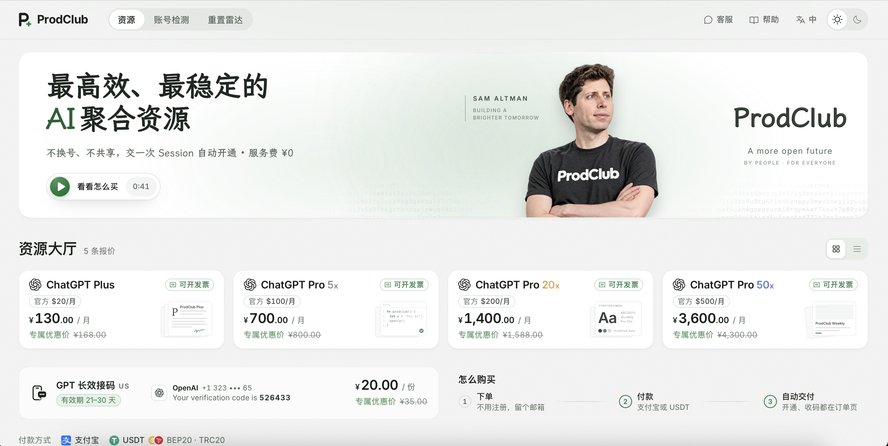
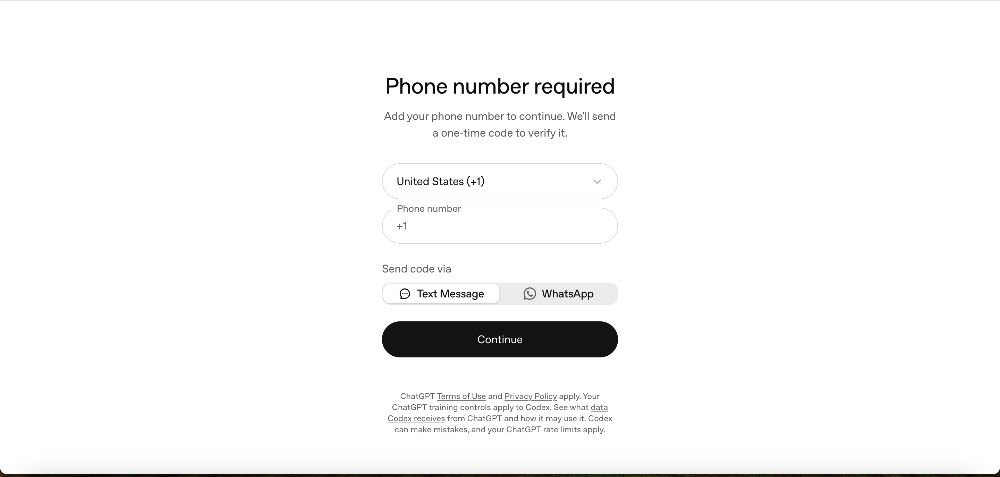
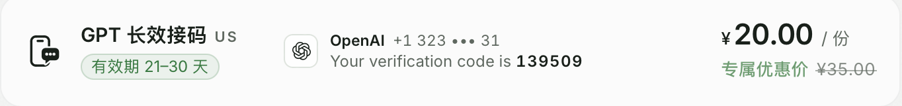
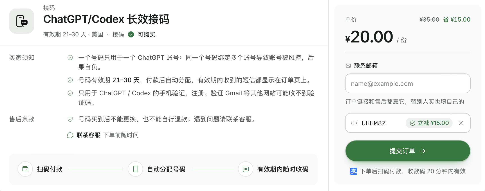
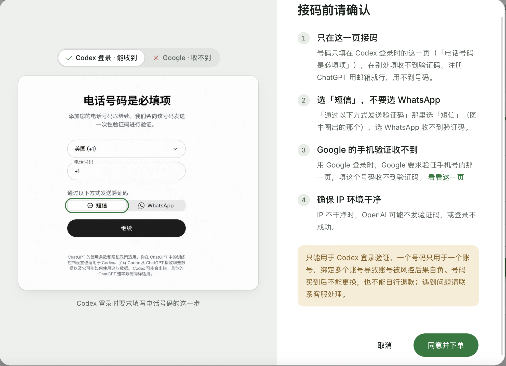

# 【亲测可用】支付宝/微信充值 ChatGPT Plus/Pro、体验 Astra、Sol、Terra、Luna｜代充完整指南

> **非官方声明：** 本项目为独立的第三方教程整理项目，与 OpenAI、Anthropic、GitHub 等公司不存在官方合作、授权或隶属关系。ChatGPT、OpenAI、Claude、Anthropic 等商标归各自权利人所有。

> **安全提示：** 第三方充值服务可能需要额外的账号授权信息，请充分了解其安全风险，不要向任何不可信第三方提供密码、验证码、Cookie、Session Token 或 API Key。

> 本文更新于 2026 年 10 月 29 日。**如果你对有帮助的话，希望给一个小⭐️⭐️支持一下，本教程持续更新**。

OpenAI 目前已经恢复 GPT Pro 订阅，不过套餐额度由此前的 20X 减半调整为 10X。

现在可以正常订阅或续费 Pro 10X，具体额度和可用功能请以 ChatGPT 账号内实际显示为准。

以下讲一讲人在国内，没有海外信用卡，怎么把自己的 ChatGPT 账号升级成 Plus/Pro（5X/10X）？

目前常见的方法包括虚拟信用卡、美区 Apple ID、找朋友代付、共享账号和第三方代充。看起来每条路都能走，真正操作时却各有门槛：有的容易支付失败，有的流程复杂，还有的虽然便宜，却无法保障聊天记录和账号安全。

如果你只想先看结论：

- 没有海外卡，又不想折腾：优先考虑支持人民币付款、订单可查询、售后规则清楚的代充平台。
- 有稳定、合规的海外支付方式：优先在 ChatGPT 官网直接订阅。
- 熟悉苹果生态：可以考虑 App Store 礼品卡。
- 共享账号：除非只是临时体验且不输入任何隐私内容，否则不建议。

## 方法一：代充网站——目前最省心的选择

### 适合谁？

代充比较适合以下用户：

- 没有海外信用卡；
- 不想研究虚拟卡和账单地址；
- 不想折腾美区 Apple ID；
- 使用安卓或 Windows，没有苹果设备；
- 临时急用 Plus/Pro（5X/10X），希望尽快完成充值；
- **公司付款，需要发票用于报销**。（这一点对我很重要）

代充网站的基本流程是：使用人民币购买 ChatGPT Plus/Pro（5X/10X）充值服务，支付后平台自动交付，会员直接开通到你的 ChatGPT 账号，全程不用换绑、不用共享，只需要交一次 Session 即可自动开通。

这里推荐一个我一直在用的代充平台 [ProdClub](https://prodclub.xyz/r/UHHM8Z?src=github)，支持支付宝、USDT（BEP20/TRC20）付款。

而且有质保，如果掉会员了，他们会按剩余天数赔偿或协助重新充值会员。

下面讲解的下单和开通流程，都以该平台为例。

👉 **[进入 ProdClub 充值 ChatGPT Plus/Pro](https://prodclub.xyz/r/UHHM8Z?src=github)**

> 不过这里提示一下，充值 ChatGPT plus 和 注册codex是否需要海外手机验证没关系。即使你是GPT plus，注册 codex一定的概率还是要手机验证的。文末有专门的 **Codex 手机验证 + 长效接码** 章节可以参考。

### 现在的价格大概是多少？

以我截图时的平台报价为例（价格会浮动，请以页面实时报价为准）：

| 套餐 | 官方价格 | 平台价/月 |
| --- | --- | --- |
| ChatGPT Plus | $20/月 | ¥130 |
| ChatGPT Pro 5x | $100/月 | ¥700 |
| ChatGPT Pro 20x | $200/月 | ¥1,400 |
| ChatGPT Pro 50x | $500/月 | ¥3,600 |

平台基本流程：下单（不用注册，留个邮箱）→ 支付宝或 USDT 付款 → 自动交付开通，收货都在订单页。

### GPT 更新后还能不能充值？

充值购买的是 **ChatGPT Plus/Pro（5X/10X）会员**，不是单独购买某一个模型。充值成功后，可以使用哪些模型和功能，以 OpenAI 当时向该套餐、账号和地区实际开放的内容为准。

OpenAI 已发布最新旗舰模型 **GPT-6 Astra**，适用于复杂推理、编程、研究和端到端任务。模型会按套餐、账号和地区逐步开放，是否可用请以 ChatGPT 账号中的模型列表为准。

持续复测记录：

- **2026 年 10 月 29 日**：平台报价和接码服务再次复测，方案仍可用。
- **2026 年 10 月 3 日**：OpenAI 恢复 GPT Pro 订阅；套餐额度由此前的 20X 减半调整为 10X。
- **2026 年 9 月 8 日**：GPT-6 Astra 发布后更新模型说明；充值购买的仍是 Plus/Pro 会员，具体模型权限以账号实际开放情况为准。
- **2026 年 7 月 31 日**：第三方服务页面、微信支付和卡密充值流程再次检查，方案仍可用。
- **2026 年 7 月 9 日**：GPT-5.6 Sol、Terra、Luna 发布后复测，方案仍可用。
- **2026 年 4 月 24 日**：GPT-5.5 发布后复测，方案仍可用。
- **2026 年 4 月 21 日**：GPT Image 2 发布后复测，方案仍可用。
- **2026 年 3 月 5 日**：GPT-5.4 发布后复测，方案仍可用。

### 选择代充平台时看什么？

代充最需要防范三类问题：付款后不到账、被要求交出账号密码、出现问题后找不到售后。

筛选平台时建议重点检查：

- 是否有明确的商品价格和充值步骤；
- 是否支持订单查询；
- 是否有可以联系到的人工客服；
- 是否要求把账号密码或验证码交给客服；
- **是否支持发票**； （一般支持开票的，都不会跑路，因为能开票就是正规企业运作的）

充值遇到任何问题，可以和客服联系，ProdClub 页面上就有客服和帮助入口。

### 优点

- **操作省事**：不用申请虚拟卡，也不用切换 App Store 地区。
- **国内支付友好**：支持支付宝，也可以用 USDT（BEP20/TRC20）。
- **交付较快**：下单后自动交付开通，流程顺利时几分钟即可完成。
- **支持开票**：该平台可以开发票用来报销。（**这一点对我很重要**）
- **售后入口明确**：提供订单查询、教程、客服和公开退款政策。

### 缺点与注意事项

- **依赖第三方平台**：安全性和长期稳定性不能等同于 OpenAI 官网直付。
- **不适合囤卡**：套餐价格和库存可能随官方规则变化，购买后应尽快使用。
- **已有 Plus 不建议直接覆盖**：剩余会员时间可能不会顺延，建议等当前会员到期后再充。

代充并非毫无风险。它的主要价值，是在没有海外支付条件时，用较低的操作门槛完成充值。请严格按照平台的最新教程操作，并妥善保护账号凭证。

## 方法二：虚拟信用卡——适合愿意自己折腾的人

### 适合谁？

适合熟悉海外支付、卡组织、账单地址和订阅管理，而且以后还需要购买其他海外服务的用户。

基本思路是申请一张可用于国际在线支付的虚拟卡，再在 ChatGPT 官网选择升级，填写卡号、有效期、CVV 和对应的账单信息。

这种方式看起来最接近官网直付，但实际门槛并不低：

- 有的平台需要开卡费、充值费和月费；
- 卡段可能被支付系统拒绝；
- 首次付款成功，不代表后续自动续费也能成功；
- 平台停止服务后，余额可能难以取回；
- 账号所在地、发卡地区和支付资料仍需符合官方规则。

过去已有热门虚拟卡服务停止运营，因此不要只参考过时教程开户，也不要一次充入过多余额。

### 优点

- 可通过 ChatGPT 官网自行完成付款；
- 卡片可能用于其他支持的海外订阅；
- 后续订阅和取消由自己管理。

### 缺点

- 开卡和充值可能产生额外成本；
- 支付风控和拒付概率不可控；
- 需要自己处理卡片余额与续费；
- 新手反复试卡可能给账号带来额外风险。

## 方法三：App Store 礼品卡——苹果用户可以考虑

### 适合谁？

适合已有 iPhone 或 iPad，并熟悉 Apple ID 商店地区、礼品卡和订阅管理的用户。

基本流程：

1. 准备符合要求的 Apple ID；
2. 购买与 Apple ID 地区一致的 Apple Gift Card；
3. 将礼品卡兑换到 Apple 账户余额；
4. 下载 OpenAI 官方 ChatGPT App；
5. 登录自己的 ChatGPT 账号；
6. 在 App 中升级 Plus，通过 Apple 余额付款。

这条路使用苹果内购体系，通常比来源不明的虚拟卡更稳妥。不过，切换 Apple ID 地区可能影响已有余额和订阅，礼品卡也可能存在溢价，操作前应先确认苹果的最新规则。

### 优点

- 通过官方 ChatGPT App 和苹果内购完成； （土耳其、菲律宾等提取价格比较便宜）
- 付款和订阅管理均在 Apple 账户体系内完成；
- 订阅可以在 Apple 账户中管理。

### 缺点

- 需要苹果设备；
- Apple ID 地区和礼品卡地区必须一致；
- 礼品卡可能有溢价，余额还需覆盖潜在税费；
- 主 Apple ID 已有其他订阅时，不适合贸然切区。

## 方法四：低价共享账号——便宜，但不建议

共享账号的操作最简单：付款后，卖家提供一组邮箱和密码，多个人登录同一个 Plus 账号。它唯一明显的优势是价格低，但问题也很直接：

- 其他人可能看到你的聊天记录；
- 上传的代码、文档和图片可能泄露；
- 卖家随时可以修改密码；
- 多人异地登录容易触发验证或限制；
- 通常会限制提问次数；
- 账号失效后很难追责。

如果只是临时查看 Plus 界面，而且完全不输入任何隐私内容，可以自行权衡。只要涉及工作资料、学习资料、简历、合同、代码或个人信息，就不要使用共享账号。

## 四种充值方法怎么选？

| 方式 | 操作难度 | 账号掌控 | 主要成本 | 适合人群 | 建议 |
| --- | --- | --- | --- | --- | --- |
| 第三方代充 | 低 | 自己的账号 | 人民币套餐价 | 没有海外卡、想省事或需要开票 | 综合较省心 |
| 虚拟信用卡 | 高 | 自己的账号 | 会员费及开卡、充值费用 | 熟悉海外支付的人 | 谨慎尝试 |
| App Store 礼品卡 | 中 | 自己的账号 | 礼品卡溢价及潜在税费 | 熟悉苹果生态的人 | 可以考虑 |
| 共享账号 | 低 | 不掌控账号 | 通常最便宜 | 只做无隐私的临时测试 | 不推荐 |

如果已经有符合官方要求的海外银行卡，直接在 ChatGPT 官网订阅仍然是最直接的选择。

## Codex 手机验证怎么办？GPT 长效接码实测

前面提过一句：充没充 Plus 和注册 Codex 是否需要手机验证没有关系。Codex 登录/注册时有一定的概率被要求验证一个**海外手机号**，国内手机号基本走不通。

如果你手里正好有一个可收短信的美国号码，直接用就行。没有的话，可以看看接码服务。

### 什么时候会触发手机验证？

OpenAI 官方页面长这样——「Phone number required」，要求添加手机号并发送一次性验证码：

注意两点：

- 手机验证是**概率性触发**的，和 IP 环境、账号状态都有关系，不是每个人都会遇到；
- 验证号码支持国家区号选择，国内 +86 不在可用范围内，所以需要海外号码。

### 接码服务的两种选择

市面上接码主要分两种：

- **一次性短效号码**：几分钱到几块钱一个，收一条验证码就作废。便宜，但问题是 OpenAI 对很多接码平台的虚拟号段风控很严，经常收不到码，而且之后再次验证时号码已经失效。
- **长效专属号码**：一个号码在一个有效期内（比如 21–30 天）归你专用，有效期内随时可以重新收码。价格贵一些，但通过率高得多，也方便后续再次验证。

我实测用的是 ProdClub 上的 **GPT 长效接码（US）**，美国号码，有效期 21–30 天：

### 下单流程

下单很简单，全程不用注册账号：

**第 1 步：确认接码须知，提交订单**

下单页会明确写出买家须知，重点这几条：

- 一个号码只用于一个 ChatGPT 账号，同一号码绑定多个账号导致账号被风控，后果自负；
- 号码有效期 21–30 天，付款后自动分配，有效期内收到的短信都显示在订单页上；
- 号码只用于 ChatGPT / Codex 的手机验证，注册、验证 Gmail 等其他网站可能收不到验证码；
- 号码买到后不能更换，也不能自行退款，遇到问题联系客服。

在「联系邮箱」里填上你自己的邮箱（订单链接和售后都靠它），输入优惠码 **UHHM8Z** 可立减 ¥15（券后 **¥20/份**），然后提交订单：

**第 2 步：接码前请确认**

提交订单前，平台会让你确认几个关键点，这几个点直接决定你能不能收到验证码，务必照做：

1. **只在 Codex 登录页接码**：号码只填在 Codex 登录时的「电话号码是必填项」这一页，在别处填收不到验证码。注册 ChatGPT 用邮箱就行，用不到号。
2. **选「短信」，不要选 WhatsApp**：在「通过以下方式发送验证码」那里选**短信**，选 WhatsApp 收不到验证码。
3. **Google 的手机验证收不到**：用 Google 登录时，Google 要求验证手机号的那一页，填这个号码收不到验证码。
4. **确保 IP 环境干净**：IP 不干净时，OpenAI 可能不发验证码，或登录不成功。

**第 3 步：扫码付款，等待收码**

下单后扫码付款（收款码 20 分钟内有效），系统自动分配号码。把分配到的美国号码（+1 开头）填进 Codex 的手机验证页，验证码短信会直接显示在订单页上。

### 接码使用的注意事项

- **一号一账号**：不要拿同一个号码去验证多个 ChatGPT 账号，容易被风控。
- **及时使用**：付款后号码立即分配并开始计算有效期，建议下单前就把 Codex 登录流程走到手机验证那一步。
- **不能更换、不自行退款**：下单前确认好需求，遇到问题先联系客服。
- **别忘了选短信**：90% 收不到码的问题都出在选了 WhatsApp 或者填错了页面。

## 常见问题

### 国内没有海外信用卡，怎么充值 ChatGPT Plus/Pro（5X/10X）？

不想折腾虚拟卡或美区 Apple ID，可以选择支持人民币付款的第三方代充平台。本文实际测试的是[前文提到的 ProdClub](https://prodclub.xyz/r/UHHM8Z?src=github)：下单后自动交付开通，会员直接到自己的账号。

### 第三方代充平台可以开发票吗？

本文提到的平台支持开发票。具体抬头、税号、开票时间和可开票范围，以下单页面或客服答复为准。

### 充值需要把 ChatGPT 密码给客服吗？

不需要，也不应该把账号密码或验证码发给客服。第三方充值服务可能需要额外的账号授权信息，请充分了解其安全风险，不要向任何不可信第三方提供密码、验证码、Cookie、Session Token 或 API Key。

### 接码收不到验证码怎么办？

先按顺序自查：是否填在了 Codex 登录的手机验证页（而不是别处）、是否选了「短信」而不是 WhatsApp、IP 环境是否干净。都确认没问题仍收不到码，凭订单联系平台客服处理。

### 已有 ChatGPT Plus 还能继续充值吗？

建议等现有会员到期后再充。强制覆盖可能导致剩余会员时间失效，并从充值当天重新计算周期。

### 充值后在哪里查看 Plus 是否到账？

刷新 ChatGPT 页面，进入账号的 Plan、Subscription 或 Account 页面查看当前套餐。充值成功后会显示 Plus 状态。

### ChatGPT Plus 包含 API 额度吗？

不包含。ChatGPT Plus 是 ChatGPT 产品订阅，OpenAI API 使用另一套独立计费体系。

## 总结

国内充值 ChatGPT Plus，真正实用的判断标准不是“哪家价格最低”，而是：

**账号是不是自己的、付款后能不能查询订单、失败后有没有售后、整个流程是否清楚透明。**

- 有合规可用的海外支付方式，优先选择官网直付；
- 苹果用户愿意处理 Apple ID 和礼品卡，可以考虑 App Store；
- 没有海外卡、不想研究虚拟卡，或需要支付宝付款和公司开票，可以考虑本文实际测试过的[第三方充值服务](https://prodclub.xyz/r/UHHM8Z?src=github)；
- 注册 Codex 遇到手机验证，可以用长效接码服务解决，记得选短信、一号一账号；
- 不要使用共享账号处理隐私内容。

👉 **[ChatGPT Plus/Pro 第三方充值入口](https://prodclub.xyz/r/UHHM8Z?src=github)**
